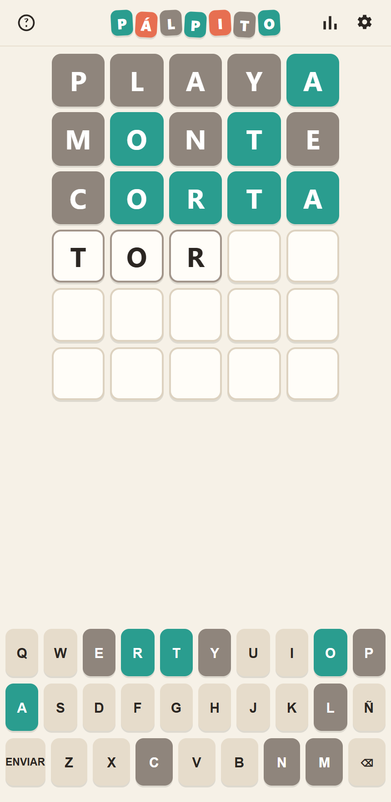
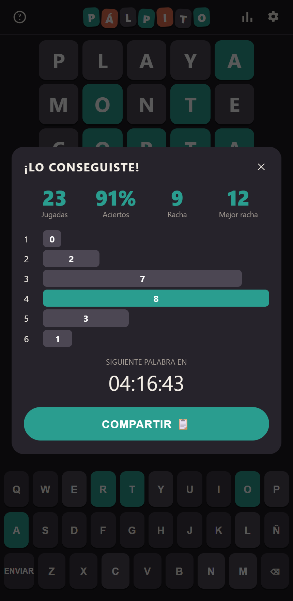
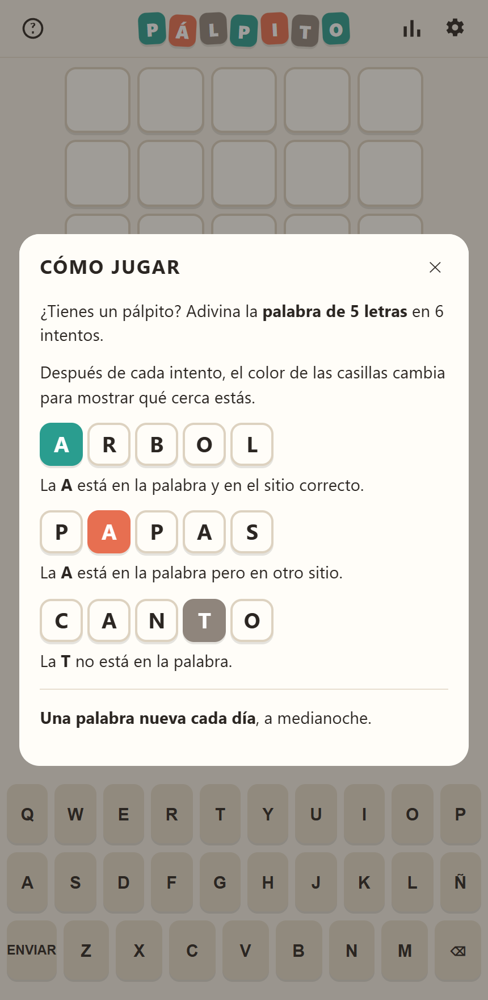

# Pálpito 🟢🟠

**¿Tienes un pálpito?** Adivina la palabra de 5 letras del día en 6 intentos.

Pálpito es un juego diario de palabras en español para la web. Cada medianoche
aparece una palabra nueva, la misma para todos los jugadores, sin servidor,
sin cuentas y sin anuncios.

<p align="center">
  
  &nbsp;
  
  &nbsp;
  
</p>

## Cómo se juega

Escribe una palabra de 5 letras y pulsa **ENVIAR**. Cada casilla cambia de color:

| Color | Significado |
|---|---|
| 🟢 Turquesa | La letra está en la palabra y en su sitio |
| 🟠 Terracota | La letra está en la palabra, pero en otro sitio |
| ⚫ Gris | La letra no está en la palabra |

Las tildes no cuentan (JAPÓN se escribe JAPON), pero la **Ñ** es una letra propia.

## Características

- 📅 **Una palabra al día**, igual para todos, que cambia sola a medianoche (hora local)
- 📖 **Diccionario de más de 10.800 palabras**, con plurales y conjugaciones
- ⌨️ Teclado en pantalla con Ñ, y teclado físico (también acepta vocales con tilde)
- 🎯 Colores correctos incluso con letras repetidas
- 📊 Estadísticas: partidas, % de aciertos, racha actual, mejor racha y distribución de intentos
- 📤 Compartir el resultado con emojis sin desvelar la palabra
- 😈 Modo difícil, 🌙 tema oscuro y ♿ modo alto contraste para daltónicos
- 💾 La partida y las estadísticas se guardan en tu navegador

## Tecnología

- **TypeScript + Vite + CSS puro**: sin frameworks ni dependencias en producción (~35 KB comprimido)
- **Sin backend**: la palabra del día se calcula en el navegador a partir de la fecha
  (días desde el 1 de enero de 2026, sobre una lista de ~570 respuestas)
- **Vitest** para la lógica del juego y las listas de palabras

## Desarrollo en local

```bash
npm install
npm run dev        # http://localhost:5173
```

| Comando | Qué hace |
|---|---|
| `npm run dev` | Servidor de desarrollo |
| `npm test` | Tests del motor y de las listas de palabras |
| `npm run build` | Build de producción en `dist/` |
| `npm run preview` | Sirve el build de producción en local |
| `npm run dict` | Regenera el diccionario de palabras aceptadas |

Atajos solo en desarrollo, para probar sin esperar al día siguiente:

| Dirección | Qué hace |
|---|---|
| `localhost:5173/?practica` | Palabra aleatoria; no guarda partida ni estadísticas |
| `localhost:5173/?reset` | Borra la partida de hoy |
| `localhost:5173/?reset=all` | Borra la partida y las estadísticas |

## Despliegue

Es un sitio 100 % estático (`dist/`). Incluye configuración para **Vercel**
(`vercel.json`) y **Netlify** (`netlify.toml`).

## Créditos

- Diccionario de palabras aceptadas: [an-array-of-spanish-words](https://github.com/words/an-array-of-spanish-words) (MIT).
- Inspirado en el género de juegos diarios de adivinar palabras.
